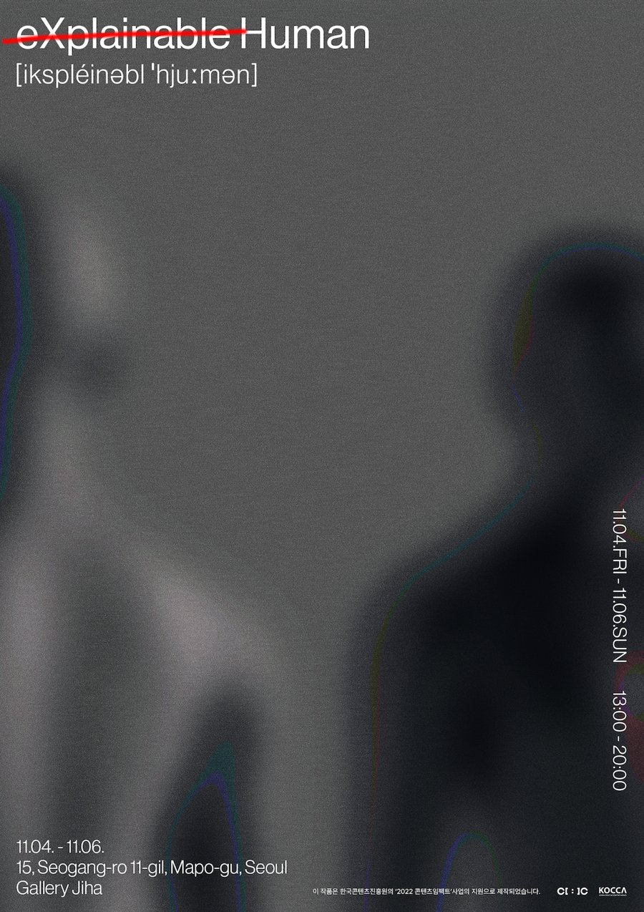
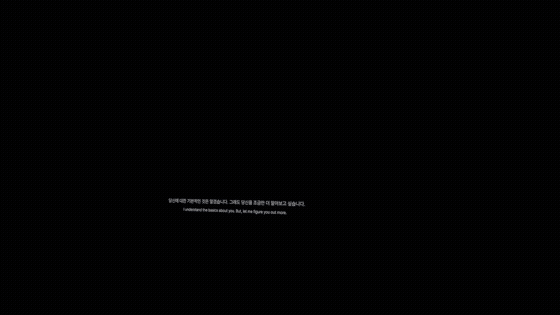
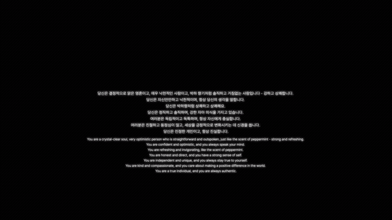

<p align="center">
  
</p>

<h1 align="center">eXplainable Human</h1>
<p align="center"><i>인공지능은 당신의 자아를 설명할 수 있을까?</i></p>
<p align="center">
  AI 인터랙티브 미디어아트 · 팀 <b>met.</b> · 갤러리 지하, 서울 · 2022.11.04–11.06<br/>
  <a href="README.md">English</a> · <a href="docs/algorithm.md">알고리즘</a> · <a href="docs/findings.md">분석 결과</a> · <a href="docs/exhibition.md">전시</a>
</p>

---

## 기획 의도

설명 가능한 인공지능(XAI)은 사람이 이해하지 못하는 AI의 판단을 설명하려는 분야입니다.
팀 met.은 이 질문을 뒤집었습니다. **설명하기 가장 어려운 '자아'를, AI는 설명할 수 있을까?**

관객은 어두운 공간에서 숨 쉬는 빛의 원 — AI — 과 마주 앉아 키보드로 13개의 질문에 답합니다.
AI는 관객의 자아를 몇 문장으로 '설명'하고, 글리치 전환 영상이 지나간 뒤 영수증 프린터로
**자아 영수증(Ego Receipt)** 을 출력합니다. 맨 아래에는 *Total Ego Amount: priceless*.

<p align="center">
  
  
</p>

▶ 전체 시연 영상(2분): [`docs/media/exhibition-walkthrough.mp4`](docs/media/exhibition-walkthrough.mp4)

## 작동 방식

1. **Lv1 인적 사항** (성별·나이·거주지·학력·결혼) → **Lv2 가치관** (사랑·증오·계절·중요한 가치·친구 중 랜덤 3개) → **Lv3 자아상** (나는 어떤 사람인가·내면의 색·AI가 나를 몇 % 이해할까·비밀)
2. 한/영 자유 응답을 **키워드 사전**으로 분류하고 문항별 가중치로 점수화
3. 레벨별 합계 점수로 미리 작성한 형용사 문장 조합(**294가지**) 중 하나를 선택
4. GPT-3(text-davinci-002)가 그 문장을 여러 문장으로 확장 → Papago로 한국어 번역 → '내면의 색'은 HEX 코드로 변환
5. 전환 영상 → AI의 설명 → 자아 영수증 출력

'설명'의 핵심은 대부분 **규칙 기반**이고, 언어 모델은 그것을 유창하고 확신에 찬 말투로 바꿔주는 역할만 합니다.
그 유창함이 '이해받았다'는 느낌을 만든다는 점이 이 작업의 포인트입니다. → [docs/algorithm.md](docs/algorithm.md)

## 결과

약 70명의 관객이 전 과정을 마쳤습니다.

- 설명을 듣기 **전**, "AI가 당신을 몇 % 이해할 수 있을까?" → 중앙값 **30%**
- 설명을 들은 **후**, "당신과 일치하나요?" → **약 80%(70명 중 56명)가 '그렇다' 또는 '어느 정도'**

관객들은 AI가 자신을 거의 이해하지 못할 거라 예상했지만, 13개의 답과 템플릿으로 만든 설명에서 대부분 자신을 발견했습니다.
**그럴듯한 설명과 정확한 설명은 받는 사람에게 똑같이 느껴진다** — XAI가 경계하는 바로 그 지점입니다. → [docs/findings.md](docs/findings.md)

## 나의 역할 — 한혜지

기획 · **데이터 모델링 · 데이터 분석**

- 자아 관련 질문 탐색 및 질문지 설계 (3레벨 · 13문항)
- 문항별 가중치와 레벨별 합산 점수를 형용사 조합(294가지)에 매칭하는 점수 모델
- 컨셉의 바탕이 된 리서치: *New media art and UX/HCI* (2022.7)
- 2026: 익명 관객 응답 재분석 (예상 vs. 인식)

## 실행

```bash
cd app && npm install
cp .env.example .env   # 선택 — 비워두면 DEMO 모드
npm start              # → http://127.0.0.1:3000 (엔터로 시작)
```

API 키 없이도 DEMO 모드로 전체 흐름을 체험할 수 있습니다. 2022년 원본 코드는 `archive/2022/`(API 키 삭제)에 있고,
2026년 정리 내용은 [README.md](README.md#2026-refresh--what-changed-and-why)에 있습니다.
관객 응답 원본은 개인적인 내용(비밀 등)이 포함되어 있어 공개하지 않습니다.

## 팀 met.

양종훈 (팀장 · 기획 · 아트디렉팅 · 비주얼 디자인) · 석정현 (기획 · 아트디렉팅 · 사운드 디자인) · 김나은 (기획 · 프로그램 개발) · 탁나영 (기획 · 공간 연출) · 한혜지 (기획 · 데이터 모델링 · 데이터 분석)

본 작품은 한국콘텐츠진흥원 **2022 콘텐츠임팩트 — 과학기술 X 미디어아트 「다빈치 프로젝트」**(2022.7–11)의 지원을 받아 제작되었습니다.
작품의 권리는 팀 met.에 있으며, 이 저장소는 포트폴리오 아카이브로 공유됩니다.
