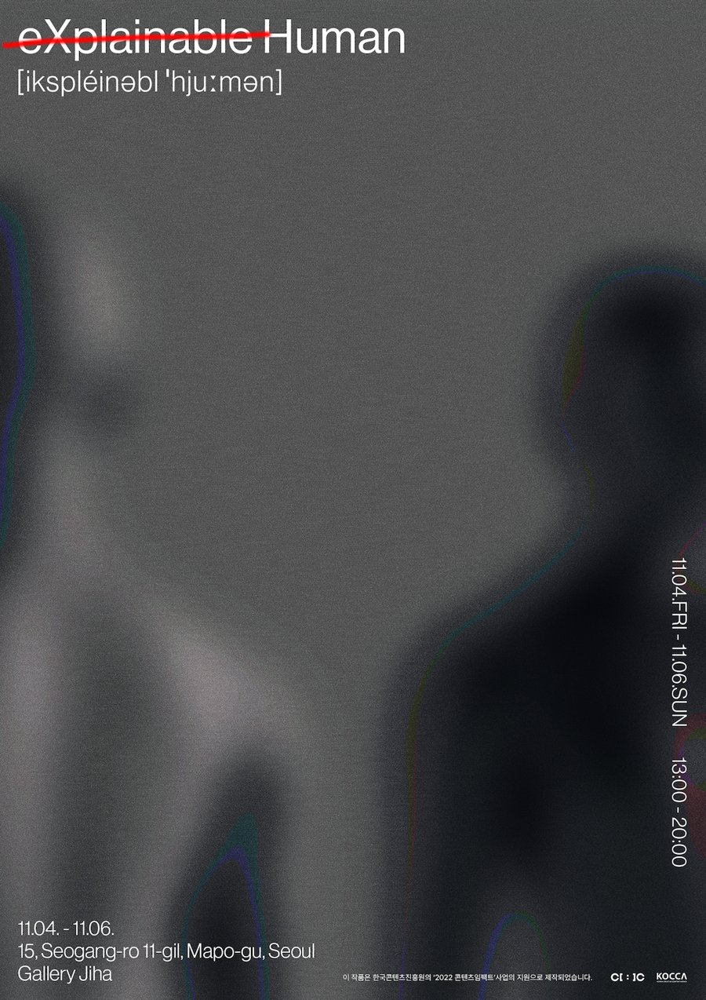
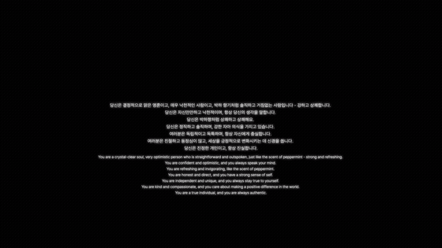

<p align="center">
  
</p>

<h1 align="center">eXplainable Human</h1>
<p align="center"><i>[ɪkspléɪnəbl ˈhjuːmən] — Can an AI explain who you are?</i></p>
<p align="center">
  Interactive AI media-art installation · team <b>met.</b> · Gallery Jiha, Seoul · Nov 4–6, 2022<br/>
  <a href="README.ko.md">한국어</a> · <a href="docs/algorithm.md">Algorithm</a> · <a href="docs/findings.md">Findings</a> · <a href="docs/exhibition.md">Exhibition</a>
</p>

---

## The idea

Explainable AI (XAI) is the field that tries to make opaque models understandable to humans.
We turned the question around: **if a human ego is the "black box," can an AI explain it?**

A visitor sits alone with a breathing circle of light — the AI — and answers 13 questions typed on a keyboard.
The AI then "explains" their ego in a few confident sentences, floods the room with a glitching transition, and
prints an **Ego Receipt**: a thermal-printer receipt itemising who they are, with *Total Ego Amount: priceless*.

The piece is built to sit in the gap between *being explained* and *recognising yourself*.

<p align="center">
  
  
</p>

▶ Full walkthrough video (2 min): [`docs/media/exhibition-walkthrough.mp4`](docs/media/exhibition-walkthrough.mp4)

## How it works

```
 visitor answers (ko / en free text)
        │
        ▼
 ┌─────────────────────────────┐   Lv1 · who you are on paper   (gender, age, home, education, marriage)
 │ rule-based text analysis     │   Lv2 · what you value         (3 of 5 random: love, hate, season, value, friends)
 │ keyword dictionaries → score │   Lv3 · how you see yourself    (self-image, inner colour, "how well can I know you?", a secret)
 └──────────────┬──────────────┘
                ▼
   3 level scores → 294 possible persona sentences (hand-written adjective bank)
                ▼
   GPT-3 (text-davinci-002) one-shot prompt expands it into a paragraph
                ▼
   Papago translates EN → KO   ·   GPT-3 turns "your inner colour" into a HEX code
                ▼
   transition video → AI speaks the explanation → thermal "Ego Receipt" is printed
```

The interesting design decision: **the "explanation" is mostly deterministic**. Free-text answers are parsed with
bilingual keyword dictionaries into scores, the scores choose from a hand-written persona bank, and only *then* does a
language model add fluent, confident elaboration. The fluency is what makes it feel like being understood.
Details in [docs/algorithm.md](docs/algorithm.md).

## What we found

About 70 visitors completed the full experience. Before the explanation, we asked *"What percentage of you do you think I can understand?"*
After it, we asked *"Does this match you?"*

| | |
|---|---|
| Visitors' **predicted** AI understanding (median) | **30%** |
| Said the explanation **matched them at least partly** | **≈ 80%** (56 of 70) |
| Said it did **not** match | 5 of 70 |

Visitors expected the AI to understand very little of them, yet most recognised themselves in a description assembled
from 13 answers and a template — a live demonstration of the Barnum/Forer effect, and of why *a fluent explanation is
not the same as a faithful one*. That gap is exactly the problem XAI research worries about.
See [docs/findings.md](docs/findings.md) for method and caveats.

## My role — Hyeji Han ([@paige-han](https://github.com/paige-han))

Planning · **data modeling · data analysis**

- Question design: explored ego-related questions and structured them into 3 levels / 13 questions
- Scoring model: per-question weights and level sums that map free-text answers to the persona bank (294 outcomes)
- Background research on new-media art × UX/HCI that framed the concept ([Jul 2022](docs/exhibition.md#research))
- 2026: re-analysed the anonymous visitor responses (prediction vs. recognition, above)

## Run it

```bash
cd app
npm install
cp .env.example .env     # optional — leave empty for DEMO mode
npm start                # → http://127.0.0.1:3000  (press ENTER to begin)
```

- **DEMO mode** (no API key): runs end-to-end with deterministic fallbacks, so anyone can experience the flow.
  Translation is passed through, so the Korean explanation is shown in English.
- **LLM mode**: set `OPENAI_API_KEY` (and optionally `OPENAI_MODEL`). `text-davinci-002` has been retired,
  so the 2022 prompt now runs through the Chat Completions API. Papago keys are optional.
- Full-screen in a browser, keyboard only. In the gallery the final `window.print()` went to a thermal receipt printer.
- Visitor answers are appended to `app/data/*.json`, which is git-ignored. Set `LOG_RESPONSES=false` to turn it off.

## Repository

```
app/                 runnable installation (2026 refresh, see below)
  server.js          Express server: answer logging, LLM expansion, colour, translation
  public/            start screen, main experience (WebGL circle shader, question flow, receipt layout)
archive/2022/        original server.js + aifunction.py as exhibited (API keys redacted)
docs/                algorithm, findings, exhibition notes, images and walkthrough video
```

### 2026 refresh — what changed and why
| 2022 | 2026 |
|---|---|
| API keys hard-coded in source | `.env` + `.env.example`; keys removed from the published history |
| `text-davinci-002` completion API | Chat Completions, model configurable |
| Papago required | Papago optional → LLM → passthrough |
| 14 copy-pasted logging routes, crash on missing file | one whitelisted route, creates files on demand |
| needed every key to run | DEMO mode |
| raw visitor answers in the repo | never committed; only aggregate findings published |

The front-end (`public/main.js`) is kept as exhibited, apart from muting errors when the background audio is missing.

## Looking back

Things I'd do differently, and a few honest bugs left in the exhibited build:

- **Consent and retention.** The last question asked visitors for a secret they had never told anyone, and many answered.
  Today I would state on the start screen what is stored and for how long, and default to not storing free text.
- **Scoring bugs.** Level 3 sums only the percentage score (the secret score is computed but never added), and a typo
  (`loveScore == 0.5`) means "10–99 things I love" scores 0. Nobody noticed during the show — which is itself a finding about how little the
  correctness of an "explanation" affects whether people believe it.
- **The colour.** The answer to "what colour is your inner self?" was converted to HEX by the model, but the final build
  replaced that background change with a fixed transition video for timing reasons.
- **Next step.** Rebuild the parser with an LLM + structured output, and show the visitor *why* each sentence was chosen —
  an actually explainable version of eXplainable Human.

## Team met.

| | Role |
|---|---|
| Jonghoon Yang | Lead · planning · art direction · visual design |
| Jeonghyun Seok | Planning · art direction · sound design |
| Naeun Kim | Planning · programming |
| Nayoung Tak | Planning · spatial direction |
| Hyeji Han | Planning · data modeling · data analysis |

Produced in **2022 Content Impact — Science & Technology × Media Art "Davinci Project"** (Jul–Nov 2022),
supported by the Korea Creative Content Agency (KOCCA, 한국콘텐츠진흥원).

All rights to the artwork belong to team met. This repository is shared as a portfolio archive.
Third-party libraries (`jquery.js`, `circle-progress.min.js`) keep their own licences.
