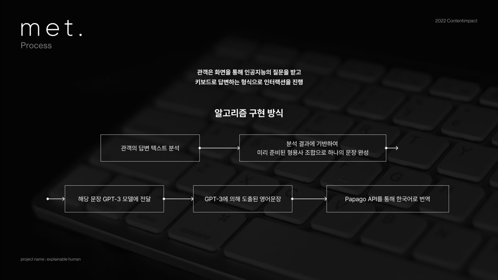
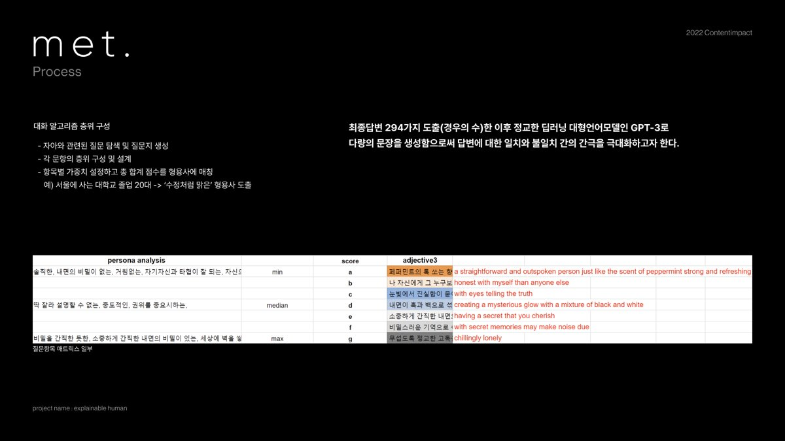

# Algorithm — how the AI "explains" a person

The installation looks like a conversation with an AI, but under the hood it's a **three-stage pipeline**:
a rule-based parser and scoring model decides *what* to say, and a language model decides *how fluently* to say it.



## 1. Question tree

| Level | Theme | Questions | Order |
|---|---|---|---|
| **Lv1** | Who you are on paper | gender · age · where you live · highest education · married? | fixed |
| **Lv2** | What you value | how many things you *love* · how many you *hate* · favourite season · most important value · how many true friends | 3 of 5, random |
| **Lv3** | How you see yourself | what kind of person are you? · what colour is your inner self? · what % of you can I understand? · a secret you've never told anyone | fixed |
| — | After the explanation | does this match you? | fixed |

Every question is asked in Korean and English, and answers are free text in either language.
Between levels the AI comments ("I understand the basics about you. But, let me figure you out more.") and the WebGL circle changes colour, radius and blur.

## 2. Parsing free text into scores

Each answer goes through a bilingual keyword dictionary, then a second classification turns the category into a score.
Example — age, which visitors answered as `26`, `26세`, `만 26세`, `스물여섯`, `twenty-six` or `300`:

```js
var ageDic = {
  2: ['스물', '스무', '이십', '약관', 'twenty', 'twenties'],   // 20s
  3: ['서른', '삼십', 'thirty', 'thirties'],                   // 30s
  // ... 0–9 → 90s, and 10 for "prefer not to say" / jokes
}
// numbers: parseInt(input) / 10 → decade;   words: search dictionary from 90s down to 10s
ageScore = (age < 3) ? 0 : 1;
```

The same pattern handles counts in words (`세 개`, `three`), regions (Seoul / metropolitan city / province / Jeju / other),
yes-no answers, and percentages. Anything unmatched falls into a "prefer not to say" bucket, which has its own score —
refusing to answer is treated as information about you.

## 3. Scores → persona sentence

Scores are summed per level and each sum selects one phrase from a hand-written bank:



| Lv1 sum (demographics) | Lv2 sum (values) | Lv3 (self-image) |
|---|---|---|
| with a crystal-clear soul | enjoying other people's attention and thinking of the world as your stage | straightforward and outspoken, like the scent of peppermint |
| 100% pure | very optimistic about dealing with the world | with eyes telling the truth |
| super-omnipresent | looking for an emotionally deep and meaningful relationship with the world | a mysterious glow from a mixture of black and white |
| like a full-grown adult | seeking both joy and deep meaning in life | having a secret that you cherish |
| like a veteran of life | contributing more than one's fair share to society | with secret memories that make noise |
| an old stager | believing happiness is only temporary | chillingly lonely |
| | making the world around you lonely, like a black cloud | honest with yourself more than anyone else |

`6 × 7 × 7 = 294` possible sentences, e.g.

> 당신은 맑은 영혼을 가진, 다른 사람의 관심을 즐기며 세상을 하나의 무대로 생각하는, 그리고 페퍼민트의 톡 쏘는 향처럼 솔직하고 거침없는 사람이네요.
> *You are a person who is with a crystal-clear soul, enjoying other people's attention and thinking of the world as your stage, a straightforward and outspoken person just like the scent of peppermint.*

## 4. Language model as the "voice"

The English sentence is sent to GPT-3 (`text-davinci-002`, temperature 1) with a one-shot prompt that shows one
source sentence expanded into seven "You are…" statements. The model continues the pattern for the visitor,
Papago translates the result to Korean, and both appear on screen and on the printed receipt.

A second prompt turns the visitor's inner colour into CSS:

```
The CSS code for a color like {deep purple}
background-color: #
```

See `app/server.js` for the current version of both prompts.

## 5. Output


The final screen and an 80 mm thermal receipt — *EGO Profile · Lev 1.0 / 2.0 / 3.0 · Total Ego Amount: priceless* — with the timestamp of the visit.

## Known issues in the exhibited build

- Lv3 sum uses only the percentage score; `secretScore` is computed but not added.
- `loveScore == 0.5` and `regionScore == 0.5` are comparisons, not assignments, so those branches score 0.
- Substring matching is order-sensitive (`female` contains `male`), handled by breaking on the first match.

These were kept unchanged in `app/public/main.js` so the archive reflects what visitors actually experienced.
