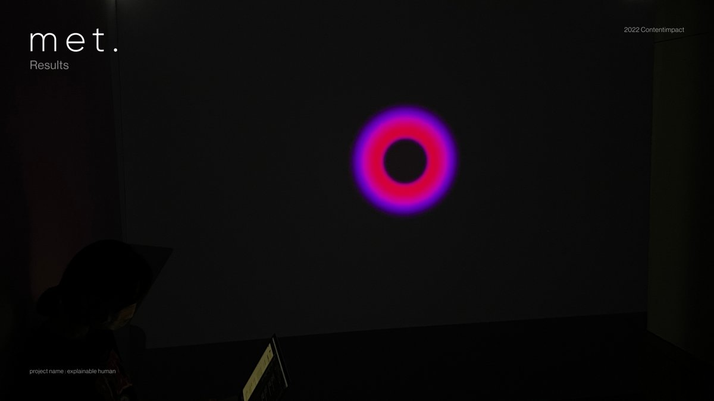
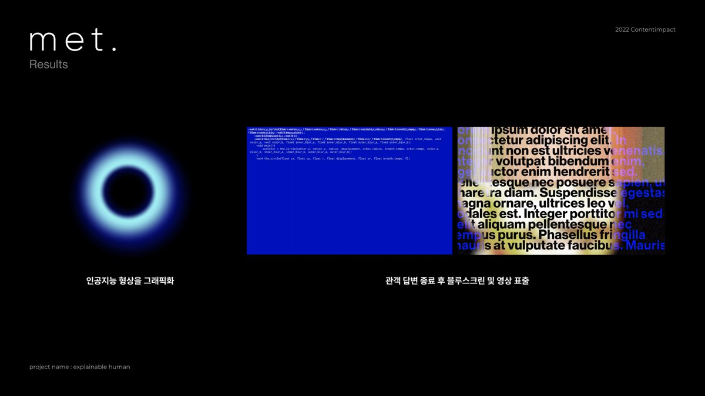
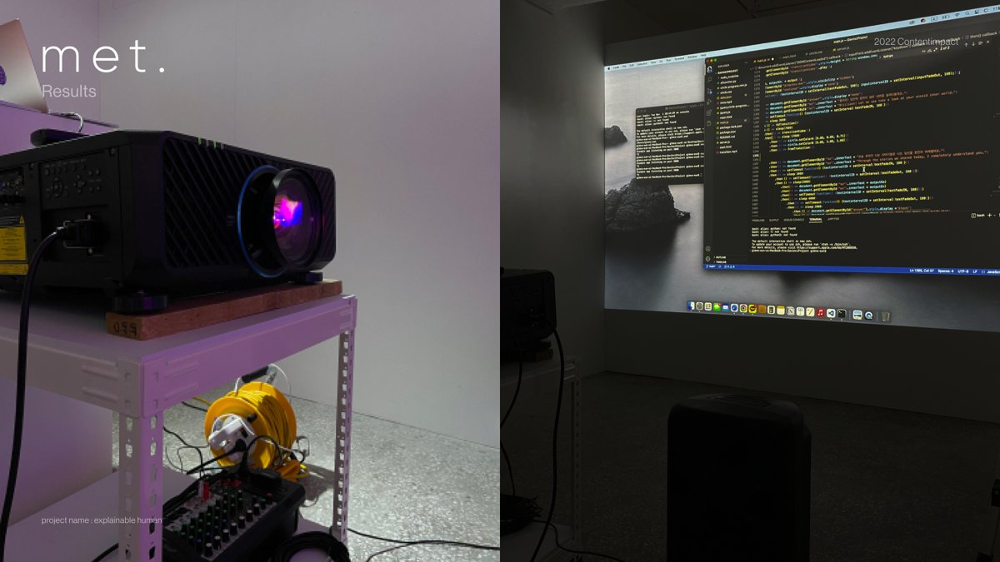
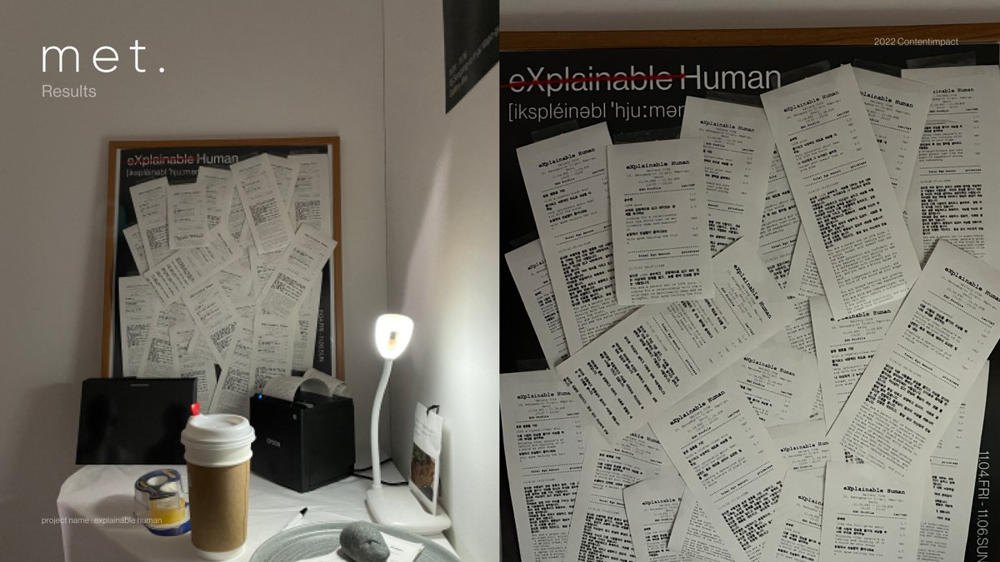

# Exhibition

**eXplainable Human** · Gallery Jiha (갤러리 지하), 15 Seongang-ro 11-gil, Mapo-gu, Seoul · Nov 4 (Fri) – 6 (Sun), 2022 · 13:00–20:00

Part of *2022 Content Impact — Science & Technology × Media Art "Davinci Project"* (Korea Creative Content Agency), Jul–Nov 2022.

## Concept

> 자아는 설명될 수 있는가? — *Can the self be explained?*

Even AI, which seems objective and complete, has parts humans cannot explain; people built the field of eXplainable AI
to understand it. Team met. took the most unexplainable subject we could think of — the ego, "what kind of person am I" —
and used AI as the instrument to try to explain it, so visitors could feel the match *and* the mismatch between the
self they know and the self that is explained to them.

The limits were part of the work: with a few minutes and a handful of questions, the AI's portrait is necessarily
narrow and fragmentary. Facing that fragment is meant to send visitors back to the question themselves.

## Space

A dark room, one keyboard, one projection. The AI has no face: it is a soft ring of light (a WebGL fragment shader of
blended blurry circles) that breathes, orbits and shifts colour as it learns about you.

After the last answer the screen breaks into a blue screen of code and glitching typography (transition video), then the AI returns in a new colour to deliver its explanation.

## Ego Receipt

Each visitor leaves with a thermal receipt: three "line items" for the three levels of their ego, the AI's full explanation in Korean and English, and *Total Ego Amount: priceless*. Visitors pinned theirs to the wall during the show.

## Research

Background research I prepared in July 2022, *New media art and UX/HCI — exploring the interaction of art and technology*:
new media art as science + art + performance; its themes (sensor-based interaction, semiotic systems, aesthetic
computing, crowd-sourcing, sound visualisation, light); and reference works such as Ishac Bertran's *code {poems}*,
Refik Anadol's *Archive Dreaming*, Rafael Lozano-Hemmer's *Pulse Room*, and *City of Sparkles*, which used sentiment
analysis on tweets to map a city's loneliness in AR/VR. The last one pointed us toward text as the input and an AI
reading people as the subject.

## Media

- Walkthrough video (2 min): [`media/exhibition-walkthrough.mp4`](media/exhibition-walkthrough.mp4)
- Poster: [`images/poster.jpg`](images/poster.jpg)
