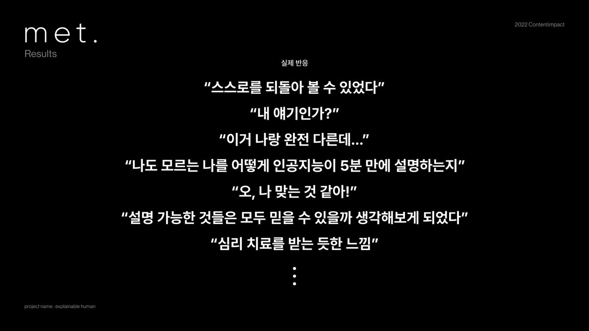

# Findings — prediction vs. recognition

*Analysis added in 2026 from the anonymous answers logged during the exhibition (Gallery Jiha, Seoul, Nov 4–6 2022).
Raw answers are not published: they include free-text secrets visitors had never told anyone. Only counts appear here.*

## Data

| Question | When | Answers logged |
|---|---|---|
| "What percentage of you do you think I can understand and explain?" | before the explanation | 72 (68 numeric) |
| "Does the explanation match you?" | after the explanation | 70 |

Counts include a handful of staff test runs during setup, so treat them as approximate.

## 1. Visitors expected little

Numeric answers to the percentage question (`30`, `30%`, `30퍼센트`, `2-30%` → first number):

- **median 30%**, mean ≈ 40%, range 0–100%
- non-numeric answers included *"이해할 수 없다"* (you can't understand me) and *"내가 나를 이해하는 것보다 작은 수준으로"* (less than I understand myself)

## 2. …but most recognised themselves

Post-experience answers, hand-coded into four groups by keyword (`네 / 일치` → yes, `어느정도 / 비슷 / 일부 / 거의` → partly, `아니` → no):

| Response | Count | Share |
|---|---|---|
| Yes, it matches | 28 | 40% |
| Partly / similar | 28 | 40% |
| No | 5 | 7% |
| Unclear (e.g. *"덜 읽음"*, *"만족!"*) | 9 | 13% |

**80% recognised themselves at least partly** in a description built from 13 answers, a keyword parser and a
294-sentence template bank, elaborated by a language model.

## 3. Visitor reactions

> "I could look back at myself." · "Is this about me?" · "This is completely different from me…" ·
> "How can an AI explain me in 5 minutes when I don't know myself?" · "It made me wonder whether I can trust everything that can be explained." · "It felt like therapy."

## Reading

- This is the **Barnum / Forer effect** in a gallery: general, flattering, confidently phrased statements feel personal.
- The model added *fluency*, not *information*: everything specific came from the rules. Perceived accuracy tracked how
  convincing the language was, not how correct the parser was (the build had scoring bugs no one noticed — see [algorithm.md](algorithm.md#known-issues-in-the-exhibited-build)).
- For XAI this is the uncomfortable part: **a plausible explanation and a faithful explanation feel the same to the person receiving it.**

## Caveats

Small, self-selected sample; free-text coding by one person; the question was asked by the "AI" itself, which invites
politeness. This is an exhibition observation, not a study.
